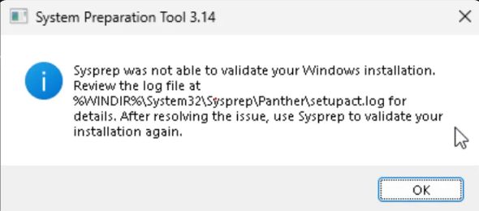
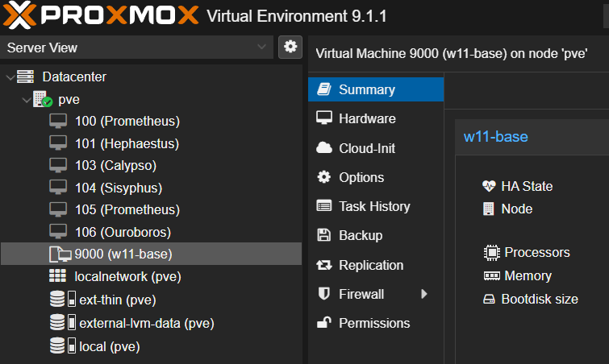

# 01 — Windows 11 Golden Image on Proxmox

**Objective → Setup → Build → Problems → Verification → Gaps**

## Objective

Build one sysprepped Windows 11 template on Proxmox that every lab endpoint (`win11-01` and later clones) is cloned from. This mirrors how enterprises image endpoints: a known-good baseline, generalized so each clone gets its own SID, hostname and OOBE, ready to domain-join and enroll in Intune.

## Setup

Template `w11-base`, VMID 9000 (from `qm config 9000`; MAC and UUIDs omitted).

| Setting | Value | Why |
|---|---|---|
| Proxmox VE | 9.1.1 (kernel 6.17.2-1-pve), QEMU 10.1.2 | |
| Windows | 11 Enterprise Evaluation 26H2, build 26300.9457 | Enterprise features (AppLocker, Credential Guard) match a corporate endpoint |
| Machine / firmware | q35 (`pc-q35-10.1`), OVMF UEFI | Win11 requires UEFI |
| Secure Boot | EFI disk with pre-enrolled keys, Microsoft 2023 certs | Win11 requirement; 2023 certs replace the expiring 2011 CA |
| TPM | v2.0 (`tpmstate0`) | Win11 requirement; enables BitLocker later via Intune |
| CPU | 2 cores, `host` type | Passes through CPU features (VBS/HVCI need virtualization extensions) |
| Memory | 4 GB, balloon min 2 GB | |
| Disk | 60 GB on LVM-thin, VirtIO SCSI single, iothread, discard, SSD emulation | Thin provisioning + discard keeps clones small |
| NIC | VirtIO on `vmbr0`, VLAN tag 100 | |
| Drivers / agent | virtio-win 0.1.221, QEMU guest agent enabled | |

## Build

1. Install Windows 11, load VirtIO storage drivers during setup.
2. Install the VirtIO guest tools and QEMU guest agent.
3. Patch fully; reboot until no updates are pending.
4. Nothing else installed. The image stays minimal on purpose: security configuration (baselines, BitLocker, LAPS, Defender) is pushed by Intune, so policy lives in one place instead of being baked into an image that goes stale.
5. Disconnect the network before sysprep (see problem 2).
6. Generalize and shut down:

   ```powershell
   C:\Windows\System32\Sysprep\sysprep.exe /generalize /oobe /shutdown
   ```

7. Convert to a template. Endpoints are then full-cloned from it:

   ```bash
   qm template 9000
   qm clone 9000 <new-vmid> --name win11-01 --full
   ```

A **full** clone is used instead of a linked clone so clones don't depend on the template's disk and can be moved or the template rebuilt independently.

## Problems

Sysprep failed twice. The dialog only says validation failed; the actual error is in `C:\Windows\System32\Sysprep\Panther\setupact.log` (and `setuperr.log`), which is the first place to look for any sysprep failure.



### 1. `0x800F0975` — reserved storage in use

**Symptom:** `setupact.log`:

```
Audit mode cannot be turned on if reserved storage is in use. An update or servicing operation may be using reserved storage. hr = 0x800F0975
```

**Cause:** Windows reserved storage holds disk space for updates and servicing. Freshly patched installs often still have it in use, and sysprep won't proceed while it is.
**Fix:** disable reserved storage, then **reboot** before running sysprep again (the change didn't take effect until after the reboot):

```powershell
DISM /Online /Get-ReservedStorageState
DISM /Online /Set-ReservedStorageState /State:Disabled
```

### 2. `0x80073cf2` — Appx package installed per-user

**Symptom:** `Package <name> was installed for a user, but not provisioned for all users. This package will not function properly in the sysprep image.`
**Cause:** A Store app was installed or updated for the setup user only (typically Store auto-updates once the VM is online). Sysprep requires every Appx package to be provisioned for all users or removed.
**Fix:** find the package named in the log and remove it:

```powershell
Select-String -Path C:\Windows\System32\Sysprep\Panther\setupact.log -Pattern '0x80073cf2' -Context 1,0
Get-AppxPackage -AllUsers -Name '<package name from the log>' | Remove-AppxPackage -AllUsers
```


**Prevention:** take the VM offline before sysprep so the Store can't reinstall apps per-user mid-process.

## Verification

- [x] Sysprep completed and the VM shut itself down
- [x] Template shows in Proxmox with the template icon



- [ ] Clone check (when `win11-01` is built): boots into OOBE and gets a unique machine SID

## Gaps

- **Evaluation license.** Enterprise Evaluation expires (90 days *(verify)*) counted from each clone's install, not the template's, so clones built late in the plan last longer. Capture write-up material before expiry.
- **Install media still attached.** The template keeps both ISOs and boots `ide2` (the installer) first, so every clone inherits them. Fix: `qm set 9000 --delete ide0,ide2 --boot order=scsi0`.
- **Old VirtIO drivers.** virtio-win 0.1.221 dates from 2022; update the drivers in the template on the next rebuild.
- **Disk size.** The template is 60 GB, while the roadmap budgets 80 GB for `win11-01`; resize the clone (`qm disk resize`) and extend C: if needed.
- **Manual build.** Each rebuild repeats these steps by hand. Next step: an `autounattend.xml` or Packer build in `infra/` so the image is reproducible.
- **Patch drift.** The template ages from the day it's sealed; clones need updates on first boot until Intune takes over patching (Month 2).
