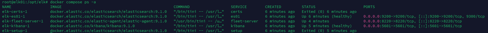
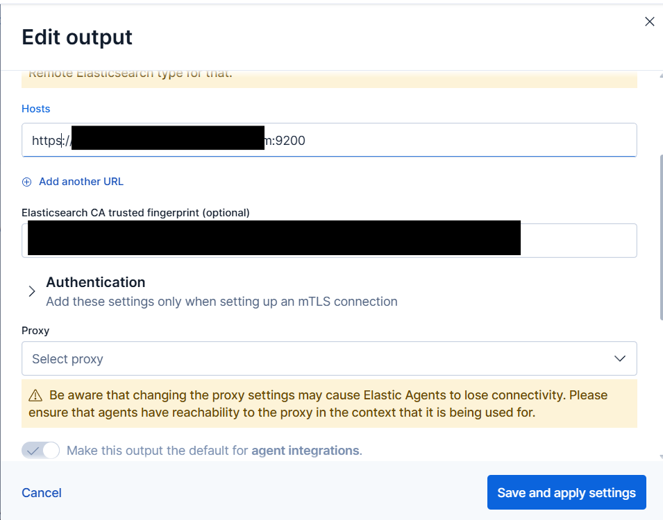
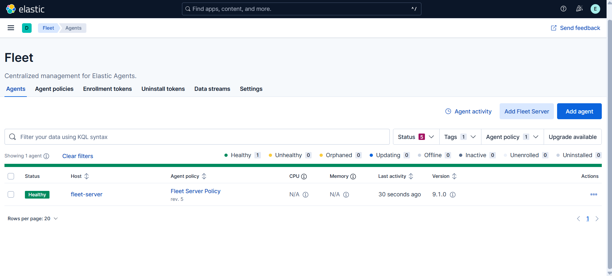

# 02 — Elastic Stack (SIEM) on Docker Compose

**Objective → Setup → Security design → Build → Problems → Verification → Gaps**

## Objective

Stand up the lab's SIEM: a single-node Elasticsearch, Kibana and Fleet Server on `elk01`, with TLS on every connection, so endpoints can enroll Elastic Agent through Fleet and ship logs straight to Elasticsearch. Everything is declared in [`elk/docker-compose.yml`](../../elk/docker-compose.yml) so the stack can be rebuilt from the repo plus one `.env` file.

**Why Fleet + Elastic Agent instead of Beats:** one agent per host instead of Winlogbeat + Filebeat + Auditbeat, policies managed centrally from Kibana, and several planned sources (Elastic Defend on Linux, Defender XDR, M365, threat intel) ship as Agent integrations. Beats remain supported, but new integrations target Agent.

## Setup

| Setting | Value | Why |
|---|---|---|
| VM | `elk01`, Debian 13.7 netinst (SSH server + standard utilities only) | Minimal attack surface; no desktop |
| CPU / RAM | 4 vCPU (`host`), 6 GB, ballooning **off** | Elasticsearch sizes its heap at start; ballooning would take memory back from the JVM |
| Disk | 150 GB, VirtIO SCSI, discard on | Retention is sized to this disk (see ILM) |
| Network | Servers VLAN (20), static DHCP reservation, local DNS record | Endpoints and Fleet reach it by FQDN; the FQDN is in the TLS certs |
| Elastic | 9.1.0, Basic license | Free tier covers SIEM, detection rules and Fleet |
| Docker | Engine 26+ | Needed for read-only volume subpath mounts (see Security design) |
| Memory split | ES 3 GB (2 GB heap), Kibana 1 GB, Fleet Server + OS the rest | Fits the 6 GB budget in the roadmap |

**Firewall rules this depends on** (OPNsense, inbound to Servers): Endpoints and the Atomic Red VLAN → `elk01` TCP 8220 (Fleet) and 9200 (Elasticsearch); Admin PC and VPN → 5601 (Kibana) and 22. Servers itself only gets DNS and NTP to the firewall plus HTTP/HTTPS out (package mirrors, Docker and Elastic registries).

## Security design

The SIEM holds every other system's logs, and every agent in the lab trusts its CA, so the stack is built to limit what one compromised container can reach.

| Control | Implementation | What it prevents |
|---|---|---|
| TLS everywhere | Elasticsearch (9200), Kibana (5601) and Fleet Server (8220) all serve HTTPS from a lab CA. Every client verifies against it; nothing disables verification | Credential sniffing and impersonation on the wire |
| CA private key isolation | `ca.key` lives only in the `ca` volume, which only the one-shot `certs` job mounts. Setup archives (`ca.zip`, `certs.zip`) are deleted after extraction | A compromised Kibana or Fleet Server minting certs that every agent would trust |
| Least-privilege cert mounts | Each service mounts only `ca.crt` and its own cert and key, read-only, via volume subpaths. Files `640`, directories `750`, owned `root:root` | One service reading another's private key; any world-readable key material |
| No superuser in Fleet Server | `setup` creates a scoped `elastic/fleet-server` service token, writes it to a volume only Fleet Server mounts (mode `600`), and Fleet Server reads it by path | The `elastic` password sitting in a long-running container's environment |
| Agents pin the CA | The Fleet output carries the CA's SHA-256 fingerprint | Agents shipping logs to an impostor Elasticsearch |
| Data retention | ILM deletes logs after 30 days and metrics after 14 | Unbounded growth filling the disk and halting ingestion |

## Build

1. Install Docker and raise the mmap limit Elasticsearch needs:

   ```bash
   curl -fsSL https://get.docker.com | sudo sh
   echo 'vm.max_map_count=262144' | sudo tee /etc/sysctl.d/99-elasticsearch.conf && sudo sysctl --system
   ```

2. Copy `elk/` to `/opt/elk`, then create `.env` from [`.env.example`](../../elk/.env.example): passwords (letters and digits), `ENCRYPTION_KEY` (`openssl rand -hex 32`), and `ELK_FQDN`/`ELK_IP`, which go into the certificates.
3. `docker compose config -q && docker compose up -d`. Startup is a chain of dependencies:

   | Service | Type | Does |
   |---|---|---|
   | `certs` | one-shot | Creates the CA (kept in the `ca` volume) and per-service certs (SANs: service name, hostname, FQDN, IP); sets permissions |
   | `es01` | long-running | Elasticsearch, HTTPS on 9200 |
   | `setup` | one-shot, after `es01` is healthy | Sets the `kibana_system` password; creates Fleet Server's service token |
   | `kibana` | long-running, after `setup` completes | HTTPS on 5601; [`kibana.yml`](../../elk/kibana.yml) preconfigures the Fleet Server policy and host |
   | `fleet-server` | long-running, after Kibana is healthy | Elastic Agent in Fleet Server mode on 8220, fixed hostname `fleet-server` |

   

4. In Kibana → **Fleet → Settings → Outputs**, point the default output at `https://<ELK_FQDN>:9200` with the CA's SHA-256 fingerprint:

   ```bash
   docker compose cp es01:/usr/share/elasticsearch/config/certs/ca/ca.crt .
   openssl x509 -fingerprint -sha256 -noout -in ca.crt | cut -d= -f2 | tr -d :
   ```

   

5. Apply the retention policies from [`elk/ilm/`](../../elk/ilm/README.md) in Dev Tools.

## Problems

### 1. `docker compose up` hung on Kibana

**Symptom:** Kibana was up (logins succeeded in its log) but stayed `health: starting`, so Fleet Server never started.
**Cause:** the health check grepped for `HTTP/1.1 302 Found`. Kibana 9 negotiates HTTP/2 when TLS is on and answers `HTTP/2 302`.
**Fix:** match either version: `grep -qE '^HTTP/[0-9.]+ 302'`.

### 2. Every `up` after the first failed: *dependency failed to start*

**Symptom:** `container elk-setup-1 exited (0)` → `dependency failed to start`.
**Cause:** Elastic's reference compose makes Elasticsearch wait for the setup container to be *healthy*. That works only while setup is still running; once it exits, Docker never reports it healthy again.
**Fix:** split setup into two one-shot jobs (`certs` before Elasticsearch, `setup` after it) and make dependents wait on `service_completed_successfully`.

### 3. Fleet Server stuck on *Waiting on default policy with Fleet Server integration*

**Cause:** recent Kibana versions no longer create a Fleet Server policy automatically, so the agent waited for one forever.
**Fix:** a `kibana.yml` is required. It preconfigures Fleet: a `fleet-server-policy` agent policy with the `fleet_server` package, plus the Fleet Server host URL. It's mounted over Kibana's default config, so it also repeats `server.host: "0.0.0.0"`. The container then enrolls into that policy via `FLEET_SERVER_POLICY_ID`.

### 4. Certificates issued for the wrong hostname

**Cause:** `ELK_FQDN` didn't match the record actually published in local DNS. Agents connecting by the real name would fail TLS hostname verification.
**Fix:** correct `ELK_FQDN`, delete only the service certs and rerun `certs`. The CA was kept, so the fingerprint configured in Fleet stayed valid.

## Verification

- [x] `docker compose ps -a`: `certs` and `setup` exited 0; `es01` and `kibana` healthy; `fleet-server` running
- [x] Fleet → Agents: one Fleet Server (`fleet-server`), **Healthy**

  

- [x] Kibana reachable over HTTPS by FQDN from the Admin PC
- [x] `docker compose exec kibana ls config/certs/ca` lists only `ca.crt` (no CA key in Kibana)
- [x] `GET _security/service/elastic/fleet-server/credential` lists only the `compose` token
- [x] `GET _ilm/policy/lab-logs` returns the policy

## Gaps

- **Single node.** No replicas, so a failed disk loses the data. Acceptable for a lab; snapshots to another host would be the next step.
- **Retention is a guess.** 30 days of logs and 14 of metrics until real ingest rates are known; check `GET _cat/allocation?v` weekly.
- **Self-signed CA.** Browsers and agents trust it only after `ca.crt` is imported. A lab CA from AD CS (`dc01`) could replace it later.
- **Secrets in container environments.** `ELASTIC_PASSWORD`, `KIBANA_PASSWORD` and `ENCRYPTION_KEY` are visible to anyone with Docker access on `elk01`, which is already root-equivalent.
- **Manual deploy.** Files reach the VM by `scp`, so the VM can drift from the repo. A `git pull` on the VM, or Ansible in `infra/`, would remove that step.
- **No log shipping from OPNsense yet.** The firewall's local logging is off and nothing is forwarded; covered by the Month 1 log-shipping item.
