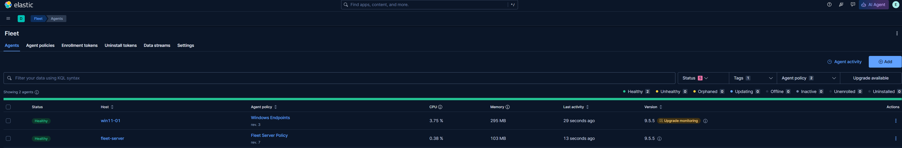
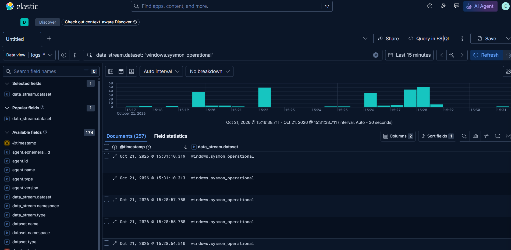
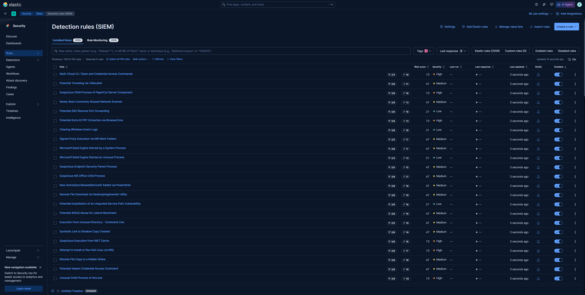

# 03 — Endpoint Telemetry: Elastic Agent + Sysmon on `win11-01`

**Objective → Setup → Security design → Build → Problems → Verification → Gaps**

## Objective

Get the first endpoint's telemetry into the SIEM: Sysmon (process, network, file, registry and DNS events) plus the Windows Security, System, Application and PowerShell logs from `win11-01`, collected by Elastic Agent through Fleet, with Elastic's prebuilt detection rules running against it.

**Log collection only, no Elastic Defend.** Elastic Defend registers as the Windows antivirus, which would push Microsoft Defender into passive mode once MDE is onboarded in Month 3. A SOC runs one EDR per endpoint; here that's MDE, and Elastic is the SIEM.

## Setup

| Setting | Value | Why |
|---|---|---|
| Endpoint | `win11-01` (clone of the [golden image](../01-golden-image/README.md)), Endpoints VLAN | |
| Elastic | 9.5.5 (stack and agents), upgraded from 9.1.0 (problem 5) | |
| Agent policy | `Windows Endpoints`, declared in [`elk/kibana.yml`](../../elk/kibana.yml) | Rebuilt with the stack; read-only in the UI, so it can't drift from the repo |
| Integrations | `system` (Security/System/Application logs, host metrics), `windows` (Sysmon, PowerShell, Defender channels) | |
| Sysmon | Latest Sysinternals build, [sysmon-modular](https://github.com/olafhartong/sysmon-modular) balanced config, release `configs-a45dedb13a43` | Community-maintained, ATT&CK-mapped; balanced profile keeps volume reasonable |
| Installer | [`scripts/powershell/Install-LabAgent.ps1`](../../scripts/powershell/Install-LabAgent.ps1) | One elevated run per endpoint; reusable for later clones and `dc01` |

**Firewall rules this depends on:** Endpoints → `elk01` TCP 8220 (Fleet) and 9200 (Elasticsearch), from the [Elastic stack](../02-elastic-stack/README.md) build.

## Security design

The installer runs as admin on every endpoint and hands the agent its trust anchor, so it's written to fail closed.

| Control | Implementation | What it prevents |
|---|---|---|
| Verified downloads | Elastic Agent zip checked against Elastic's published SHA-512; `Sysmon64.exe` must have a valid Authenticode signature from Microsoft; `sysmonconfig.xml` checked against the release's `SHA256SUMS` | Running a tampered or truncated binary/config as SYSTEM |
| Pinned versions | Agent version and sysmon-modular release tag are script parameters with fixed defaults | Silent config changes between endpoints; detections behave the same on every host |
| CA stored admin-write only | The agent keeps the *path* to the CA, not its contents, so the script copies `ca.crt` to `C:\Program Files\LabCA\` (problem 2) | A standard user swapping in their own CA and pointing the agent at a fake Fleet Server |
| Token kept out of the SIEM | Agent installs **before** Sysmon, and the enrollment token is revoked after use (problem 3) | A reusable enrollment token sitting in `process.command_line`, readable by anyone with log access |
| No secrets in the repo | FQDN, token and CA path are mandatory parameters | |
| Exit codes checked | `$LASTEXITCODE` after every native call (`ErrorActionPreference` doesn't cover them) | A half-finished install that looks successful |

## Build

1. **Policy.** Copy `elk/kibana.yml` to `elk01` and restart Kibana; Fleet creates the `Windows Endpoints` policy.
2. **CA.** Pull `ca.crt` from the stack: `docker compose cp es01:/usr/share/elasticsearch/config/certs/ca/ca.crt .`
3. **Token.** Fleet → Enrollment tokens → create one for `Windows Endpoints`.
4. **Install.** Copy the script and `ca.crt` to the endpoint; in an elevated PowerShell:

   ```powershell
   Set-ExecutionPolicy -Scope Process Bypass
   C:\Temp\Install-LabAgent.ps1 -FleetUrl https://<elk01 FQDN>:8220 -EnrollmentToken <token> -CaCert C:\Temp\ca.crt
   ```

   The script enrolls the agent, then installs Sysmon with the sysmon-modular config (or only updates the config if Sysmon is already installed).
5. **Clean up.** Revoke the token; delete `C:\Temp\ca.crt` and the script.
6. **Rules.** Security → Rules → Add Elastic rules → install all. Enable only the ones this data can feed:

   ```
   POST kbn:/api/detection_engine/rules/_bulk_action
   {
     "action": "enable",
     "query": "alert.attributes.tags:(\"Data Source: Sysmon\" OR \"Data Source: Windows Security Event Logs\")"
   }
   ```

   155 of 2,059 rules enabled. Enabling everything would waste a 2 GB heap on rules for data sources the lab doesn't have (Elastic Defend, cloud, Okta).

## Problems

### 1. sysmon-modular config returned 404

**Symptom:** the script failed downloading `raw.githubusercontent.com/olafhartong/sysmon-modular/master/sysmonconfig.xml`.
**Cause:** the project stopped committing the built configs; they're now published as GitHub Release assets with a `SHA256SUMS` manifest.
**Fix:** download from a pinned release tag and verify against `SHA256SUMS`. This also replaced a "pull from `master`" shortcut with a reproducible config.

### 2. CA file in a user-writable location

**Found in review, before it was exploited.** The first version copied the CA to `C:\ProgramData\LabCA\`. Standard users can create folders under `ProgramData`, so one could pre-create `LabCA`, own it, and later replace `ca.crt`.
**Fix:** `C:\Program Files\LabCA\`, which only admins and SYSTEM can write to. Moving an enrolled agent's CA means re-enrolling (`elastic-agent uninstall`, rerun the script), since the path is stored at enrollment.

### 3. Enrollment token captured by Sysmon

**Cause:** the first version installed Sysmon first, so Sysmon Event 1 recorded `elastic-agent.exe install ... --enrollment-token <token>`, and the agent then shipped that event to Elasticsearch. Enrollment tokens are reusable until revoked.
**Fix:** install the agent first, and revoke the token after every enrollment. Revoking still matters: re-enrolling a host that already runs Sysmon logs the token again, and so will Security event 4688 once `dc01`'s audit policy records command lines.

### 4. Agent Healthy, no data in Elasticsearch

**Symptom:** Fleet showed the agent Healthy, but `_cat/indices` returned nothing, not even Fleet Server's own logs. Agent logs:

```
The remote server's certificate is presented without its certificate chain. Using 'ca_trusted_fingerprint'
requires that the server presents a certificate chain that includes the certificate's issuing certificate authority.
x509: certificate signed by unknown authority
```

**Cause:** "Healthy" only covers the agent's connection to Fleet Server (8220). Data goes straight to Elasticsearch (9200) over a separate TLS connection, verified with `ca_trusted_fingerprint`, which pins the CA by matching its hash against the certificates the server presents. Elasticsearch presented only its leaf certificate, so there was nothing to match.
**Fix:** the `certs` job in [`docker-compose.yml`](../../elk/docker-compose.yml) now writes `es01-chain.crt` (leaf + CA) on every run, and Elasticsearch serves that. The CA didn't change, so the fingerprint in Fleet stayed valid. Check: `openssl s_client -connect localhost:9200 -showcerts </dev/null | grep -c 'BEGIN CERTIFICATE'` returns `2`.

### 5. Event-log inputs stuck in `STARTING`

**Symptom:** metrics arrived, but no Sysmon or Security events. `elastic-agent status` showed every `winlog` stream at `Starting to read from …`, and the component's metrics showed `pipeline.clients: 0`. The agent logs had:

```
Input crashed with: input panic with: name winlog-windows_sysmon_operational-windows-windows-endpoints already used
... winlogbeat/eventlog.newInputMetrics → monitoring.(*Registry).Add
```

**Cause:** a bug in Elastic Agent 9.1.0: each winlog stream tries to register its metrics under a name that's already registered, panics, and never starts reading. Restarting only repeats the crash. Not a policy problem; every stream ID is unique.
**Fix:** upgrade the stack and agents to 9.5.5 (`STACK_VERSION` in `.env`, then Fleet → Upgrade agent, Fleet Server first). Elastic's version API listed 9.5.6, but its images and downloads weren't published yet, so the pull failed. Check that a tag exists in the registry before pinning it.

## Verification

- [x] Fleet → Agents: `win11-01` and `fleet-server` **Healthy** on 9.5.5

  

- [x] `elastic-agent status`: all `winlog` streams `HEALTHY`
- [x] `elastic-agent inspect`: `certificate_authorities` is `C:\Program Files\LabCA\ca.crt`
- [x] Discover: `data_stream.dataset : "windows.sysmon_operational"` returns events

  

- [x] Discover: `data_stream.dataset : "system.security"` returns events
- [x] Enrollment token revoked; old agent entry unenrolled; `C:\Temp` and `C:\ProgramData\LabCA` removed
- [x] 155 prebuilt rules enabled (tags `Data Source: Sysmon`, `Data Source: Windows Security Event Logs`)

  

- [ ] Rule Monitoring: no failed rules (not yet checked)
- [ ] An alert fired from real activity: none yet. Comes with the Atomic Red Team baseline.

## Gaps

- **No alert has fired.** The pipeline is proven up to "rules are enabled", not "rules detect". The Atomic Red Team baseline closes this.
- **Untuned rules.** 155 rules running on defaults; expect false positives once the endpoint is used. Tuning gets logged per rule.
- **Unneeded streams.** The default policy also enables `ForwardedEvents` and two Linux log-file streams (`system.auth`, `system.syslog`). They collect nothing on Windows; kept for now, and can be disabled in `kibana.yml` if they add noise.
- **Duplicate history.** Re-enrolling reset the agent's read position, so older events were ingested twice. They age out with the 30-day retention.
- **Sysmon binary isn't pinned.** Sysinternals only publishes the latest build; the signature check proves it's Microsoft's, not which version. The config targets Sysmon 15.x.
- **Manual install.** One script run per endpoint. Intune (Month 2) should deploy the agent and Sysmon as Win32 apps.
- **No snapshot before the upgrade.** The 9.1 → 9.5 upgrade ran without an Elasticsearch snapshot; acceptable with a day of data, not later.
